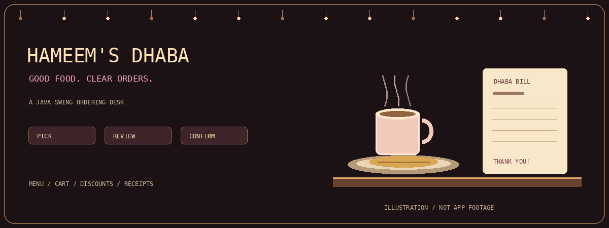

<div align="center">



# Hameem's Dhaba Ordering System

### Good food. Clear orders.

A Java Swing desktop project for choosing menu items, building an order,
applying discounts, and generating a customer receipt—with local file storage
and an object-oriented service layer behind the counter.

`Java` · `Swing` · `AWT` · `OOP` · `Local File I/O`

[Features](#behind-the-counter) · [Run locally](#open-the-dhaba) · [Workflow](#take-your-first-order) · [Design](#the-object-oriented-design) · [Limitations](#current-limitations)

</div>

---

## A small counter with a whole workflow behind it

Click a dish. Watch the order take shape. Review the total, note a discount,
enter customer details, and confirm a receipt.

Hameem's Dhaba turns that familiar restaurant-counter interaction into a desktop
program. It is an educational ordering prototype demonstrating GUI events,
encapsulated models, an order-service interface, and file persistence—not an
online delivery platform, payment gateway, or production point-of-sale system.

The application uses local files and has no network integration in the reviewed
ordering path. After installing a JDK and obtaining the source/assets, that path
can be explored offline. This does not establish multi-terminal or production readiness.

The animated banner is illustrative artwork, not a screenshot or application recording.

## Behind the counter

| Area | What the source provides |
| :--- | :--- |
| Menu | Available food and drink buttons, prices, and item images where found. |
| Cart | Repeated additions aggregate quantities; summary displays item details. |
| Corrections | Remove the most recently added unit, or clear the active order. |
| Totals | Subtotal and discount-aware total calculation. |
| Discounts | A manual percentage, applied after confirmation; customer-tier discount logic. |
| Customer form | Name, age selection, and radio-button input. |
| Receipt | An on-screen text bill with customer, item, timestamp, status, and total details. |
| Cash helper | Optional cash input and displayed change calculation. |
| Storage | Serialized order/customer files and a generated text report. |
| Feedback | A status label for actions and errors. |

The receipt area is an on-screen text view. Physical printing, PDF export, online
payments, stock synchronization, and a kitchen dashboard are not established by
the reviewed implementation.

## The desktop layout

```text
+---------------------------------------------------------------+
| Remove Last | Clear Order | Confirm Order | Show Total | Logo   |
+--------------------+--------------------+-----------------------+
|                    | Discount controls  | Customer details      |
| Menu item buttons  +--------------------+ Cash input             |
|                    | Order summary      | Receipt history view  |
+--------------------+--------------------+-----------------------+
| Status message                                                |
+---------------------------------------------------------------+
```

The main window starts at 1400 × 800. Fonts and available screen space can affect
layout, so test on the display you intend to use.

## Open the dhaba

### Requirements

- A Java Development Kit with `java` and `javac` available on PATH.
- A graphical desktop session for Swing.
- The repository's `images` and `Data` folders kept in their expected locations.

A supported JDK such as 17 or 21 is a reasonable development choice; this guide
does not claim a tested minimum Java version or a verified compatibility matrix.
No Maven/Gradle configuration or third-party JAR dependency appeared in the
reviewed root/source files.

### 1. Clone the project

```bash
git clone https://github.com/Hameem-Bhai/Dhaba_Ordering_System.git
cd Dhaba_Ordering_System
java -version
javac -version
```

Before testing, back up `Data/`. Confirmation rewrites local data files, and the
current startup does not reload saved order/customer history into the service.
Use fictional customer details.

### 2. Compile from source

Run from the repository root:

```bash
javac -encoding UTF-8 -d out Start.java Frame/MainFrame.java Entity/*.java
```

The UTF-8 flag preserves source characters such as the taka symbol. Compile fresh
source rather than relying on the committed `.class` files, which may be stale or
built for a different Java version.

### 3. Launch

Windows:

```powershell
java -cp "out;." Start
```

macOS / Linux:

```bash
java -cp "out:." Start
```

The root `.` is included so classpath resource lookups can find the `images/`
folder. Keep the working directory at the repository root because storage paths
such as `Data/data.txt` are relative.

These are source-informed commands; compilation and desktop execution have not
been performed while preparing this documentation.

## Take your first order

1. Click available menu items. Repeated clicks increase their quantities.
2. Use Remove Last Item to undo the latest added unit, or Clear Order to reset.
3. Enter a percentage and click Apply Discount if testing manual discounts.
4. Use Show Total to inspect the current amount; manual discount is not active yet.
5. Enter fictional customer information and, optionally, a cash amount.
6. Confirm Order to lock the manual discount, append a receipt, and attempt file saves.
7. Inspect the status and generated files, then start another test order.

Cash handling is a calculation helper, not payment verification. The current code
can show negative change and does not reject insufficient tender before confirming.

## How discounts work

The implementation chooses the larger of these two amounts, rather than stacking them:

```text
customer-tier discount = subtotal × customer discount rate
manual discount        = subtotal × manual percentage / 100
                         (enabled after confirmation)

discount = max(customer-tier discount, enabled manual discount)
total    = subtotal - discount
```

The input checks the 0–100 range, but should also explicitly reject non-finite
numbers such as NaN. The confirmation flow updates customer statistics, so tests
should verify that a receipt's total remains stable after tier updates and later orders.

## The object-oriented design

```text
Start
  └── MainFrame (Swing UI / event handlers)
        ├── MenuManager → available menu items
        ├── OrderService → OrderServiceImpl
        │                    └── Order → OrderItem → MenuItem
        ├── Customer
        └── DataManager → local records and reports
```

| Concept | Example in this project |
| :--- | :--- |
| Encapsulation | Model fields and validated operations in `Order` and `OrderItem`. |
| Service abstraction | `OrderService` interface and `OrderServiceImpl`. |
| Polymorphic use | Food/drink items handled through the menu-item type. |
| Composition | An order contains order items and references a customer. |
| Collections | A linked map aggregates items; a history list tracks last-unit removal. |
| Event handling | Swing buttons dispatch actions to `MainFrame`. |
| File I/O | Menu text loading, Java serialization, and text report generation. |

The service has additional history, revenue, popularity, and date-filtering helpers.
Their presence does not imply a corresponding dashboard is exposed in the GUI.

<details>
<summary>Repository structure</summary>

```text
Dhaba_Ordering_System/
├── Start.java
├── Frame/
│   └── MainFrame.java
├── Entity/
│   ├── Customer.java
│   ├── MenuItem.java
│   ├── Food.java / Drinks.java
│   ├── Menu.java / MenuManager.java
│   ├── Order.java / OrderItem.java
│   ├── OrderService.java / OrderServiceImpl.java
│   └── DataManager.java
├── images/
├── Data/
│   ├── data.txt
│   ├── orders.dat
│   ├── customers.dat
│   └── reports.txt
└── docs/assets/dhaba-counter.gif  # Added by this README pack
```

The repository also contains compiled `.class` files. Prefer tracking source and
rebuilding compiled output locally.

</details>

<details>
<summary>Data files and menu customization</summary>

| File | Purpose |
| :--- | :--- |
| `Data/data.txt` | Pipe-delimited menu records loaded by `MenuManager`. |
| `Data/orders.dat` | Java-serialized order list written by `DataManager`. |
| `Data/customers.dat` | Java-serialized customer list. |
| `Data/reports.txt` | Overwritten text summary of order/customer data passed to the writer. |

Menu records use:

```text
Type|Name|Price|Description|ImagePath|Available
```

Recognized type values in the loader are `Food` and `Drinks`. Keep six fields and
avoid unescaped `|` characters inside fields. Use valid prices and boolean values.

The GUI currently derives image filenames from item names, not the saved
`ImagePath`: lowercase the name, replace spaces with underscores, and add `.jpg`.
For example, `Dudh Cha` maps to `images/dudh_cha.jpg`. The logo lookup uses `logo.jpg`.

Menu serialization does not preserve every food/drink-specific property. Extend the
format and round-trip tests before relying on custom subtype attributes surviving reload.

The current UI passes a one-customer list to `saveCustomers`, and the order service
starts with an empty in-memory history. Saving is not proof of complete customer
history or restoration across restarts. Back up demonstration data before testing.

Only use trusted serialized `.dat` files. Do not load downloaded/untrusted Java
serialized objects into the application. Keep real customer information out of Git.

</details>

## Current limitations

1. The GUI reuses one mutable `Customer` object when creating subsequent orders.
   Earlier orders can therefore appear linked to later customer details. Create a
   separate customer snapshot/reference per order with explicit identity handling.
2. Startup creates an empty order-service history rather than restoring saved
   orders/customers. A later save can overwrite earlier-run records.
3. The report writer counts all supplied orders, while another revenue helper
   filters confirmed/completed orders. Use one definition of reportable sales.
4. Confirmation precedes cash validation, permits insufficient tender, and does
   not make all file saves atomic. Separate validation, commit, and receipt steps.
5. The form includes a joke gender option. Remove it and consider removing age and
   gender entirely unless they serve a clear purpose in this ordering workflow.
6. `Start.main` constructs Swing directly instead of scheduling it on the event
   dispatch thread. Use `SwingUtilities.invokeLater`; move slow I/O off that thread.
7. `double` is used for currency. Prefer fixed minor units or `BigDecimal` with an
   explicit rounding policy for a more reliable billing implementation.
8. Backup code uses a `cafe/Data/...` prefix inconsistent with main storage paths.
9. No automated test suite, passing build, packaged installer, or production
   reliability guarantee is established by this README.

## A strong next milestone

- Add unit tests for cart quantities, removal order, discount boundaries, and cash validation.
- Test two distinct customers without mutating the first customer's receipt/history.
- Test save → restart → reload → new order without losing records.
- Confirm failed writes cannot leave a misleading success receipt.
- Add real screenshots using fictional data.
- Add a `.gitignore` for `out/`, `*.class`, and appropriately selected runtime files.
- Choose a license and document how artwork/image assets may be reused.

Ignore rules do not remove files already tracked by Git. Review staged removals
before cleaning compiled output; retain your source and menu fixtures.

## Troubleshooting

| Symptom | Check |
| :--- | :--- |
| `javac` is not recognized | Install/configure a JDK, not only a runtime. |
| Main class not found | Compile successfully; run `Start` with the platform-specific classpath above. |
| Images missing | Include the root resource directory and check lowercase filename mapping. |
| Blank or reset menu | Inspect menu format and numeric fields; back up before fixing malformed data. |
| Saved records seem lost | Check the startup/history-overwrite limitation, not only file existence. |
| Window looks crowded | Test desktop scaling and available space; the initial window is 1400 × 800. |
| Data cannot save | Use a writable project directory and inspect the displayed save error. |

## License

No top-level LICENSE appeared in the reviewed listing. Add an explicit license
before advertising code reuse permissions; food photography and logos may need
separate rights information.

---

<div align="center">

Built by [Hameem](https://github.com/Hameem-Bhai).

**A little hospitality. A little Java. A whole order of learning.**

</div>
